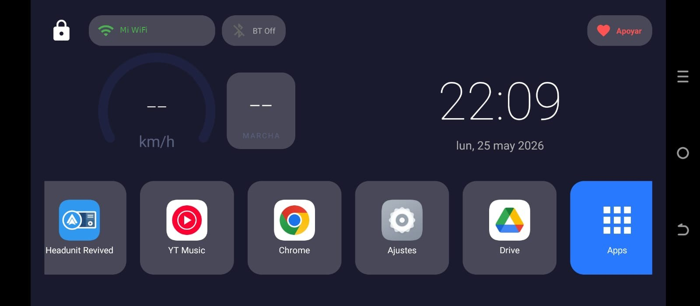

# AlsvinLaunch

Launcher para el head unit (radio Android) del auto, pensado para pantallas horizontales y para usarse mientras conduces: botones grandes, información clara y acceso rápido a lo que más usas.

Desarrollado por **Código y Café** · Paquete `codigo.cafe.alsvinlaunch`

[Disponible en Google Play](https://play.google.com/store/apps/details?id=codigo.cafe.alsvinlaunch)



## Funciones

- **Accesos directos**: cinco botones configurables (música, navegación, teléfono, radio, ajustes…). Mantén presionado para cambiar la app de cada uno.
- **Velocímetro GPS**: muestra tu velocidad en km/h.
- **Indicador de marcha**: estima la marcha según la velocidad, con rangos configurables por tipo de motor.
- **Reproductor de audio**: controla música, radio o cualquier app de audio sin salir del launcher.
- **Reloj y fecha**, con pantalla de bloqueo (doble toque para desbloquear).
- **Estado de WiFi y Bluetooth** en tiempo real.
- **Contactos rápidos** por Bluetooth: importa contactos del teléfono y llama con un toque.
- **Control de volumen** por canal (música, Bluetooth, tono, alarma, notificaciones, sistema).
- **Lista de apps** con pestañas para apps normales y apps del sistema del head unit (cámara de reversa, configuración, USB…).
- **Modo kiosk**, temas y color de fondo dinámico.
- **Tour guiado** la primera vez que se abre.
- Idiomas: **español** e **inglés**.

## Requisitos

- Android **6.0 (API 23)** o superior.
- Pantalla horizontal (head units de 7"/9"/10").
- Para usarlo como pantalla de inicio, elige AlsvinLaunch como launcher predeterminado.

### Permisos que usa

| Permiso | Para qué |
| --- | --- |
| Ubicación | Velocímetro GPS |
| Bluetooth | Estado BT, contactos y llamadas |
| Acceso a notificaciones | Widget de música |
| WiFi / red | Indicador de conexión |
| Inicio al arrancar | Abrir el launcher al encender el radio |
| Cerrar procesos en segundo plano | Liberar RAM desde el launcher |
| Facturación de Google Play | Donaciones opcionales |

## Compilar

Necesitas [Android Studio](https://developer.android.com/studio) (o el Android SDK) y JDK 17.

```bash
git clone https://github.com/CodigoyCafe01/alsvin-launcher.git
cd alsvin-launcher
./gradlew assembleDebug        # en Windows: gradlew.bat assembleDebug
```

El APK queda en `app/build/outputs/apk/debug/`. Para instalarlo en el radio por USB o red:

```bash
adb install -r app/build/outputs/apk/debug/app-debug.apk
```

### Build de release (opcional)

Solo hace falta para publicar. Copia `keystore.properties.example` como `keystore.properties` y rellena los datos de tu propio keystore. Ese archivo y los `.jks`/`.keystore` están en `.gitignore` y **nunca** deben subirse al repositorio.

```bash
./gradlew bundleRelease
```

## Estructura

```
app/src/main/java/codigo/cafe/alsvinlaunch/
├── MainActivity.java   Pantalla principal
├── activity/           Lista de apps, selector, volumen, bloqueo, tema 2…
├── managers/           Velocímetro, marchas, media, Bluetooth, reloj, kiosk, donaciones…
├── services/           Servicio de notificaciones y arranque al encender
├── views/              Vistas personalizadas (velocímetro)
├── model/, util/       Modelos y utilidades
docs/screenshots/       Capturas para este README
```

## Stack

Java 8 · Gradle (version catalog) · compileSdk/targetSdk 36 · minSdk 23 · AppCompat · Material Components · Palette · Google Play Billing.

## Contribuir

Los issues y pull requests son bienvenidos.

- Cada texto nuevo va en `res/values/strings.xml` **y** en `res/values-en/strings.xml`.
- Mantén la compatibilidad con Android 6 (API 23): si usas una API más nueva, protégela con `Build.VERSION.SDK_INT`.
- Comprueba que `./gradlew assembleDebug` compila antes de abrir el PR.

## Apoyar el proyecto

AlsvinLaunch es gratis. Si te resulta útil, puedes apoyar con una donación desde el botón **Apoyar** dentro de la app.

## Licencia

Pendiente de definir.
